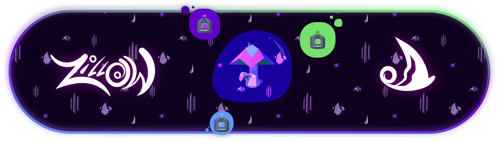
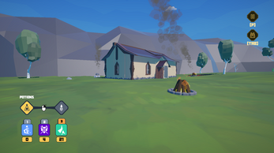
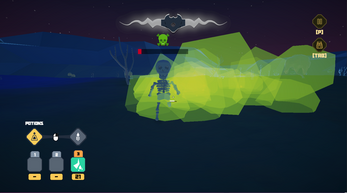
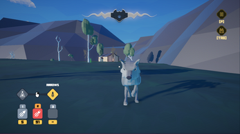

<!-- Header banner: recommended ~1280x320 (4:1) PNG or JPG -->

  

# ZILLOW

A first-person survival crafting game about a lost alchemist in the jungle. Darkness has swallowed the land, and you have to purify it by defeating the Corruption. Made in two weeks for a game jam, with the theme **"Shadows and Alchemy"**.

  

  

  
  

## Gameplay

Light is your lifeline. At night, the shadows hurt you whenever you're outside your house, and the dark areas of the jungle hurt you at any time. So the game splits into two rhythms:

- **Night:** stay near home and prepare. Farm and plant bamboo, extract essences, and craft arrows and potions.
- **Day:** venture further from your house for loot, fighting wolves, skeletons and bats along the way, and get stronger.
- **Endgame:** gather materials for a **corruption stone**, craft it in the alchemy pot to spawn the boss, and defeat the spider in the darkest region.

## Features

- **Crafting stations:** an Essence Extractor (turns mushrooms, berries and bones into essences and powder, and bamboo into seeds), a Fletching Table for arrows, and an Alchemy Pot for potions
- **Three arrows:** normal, wolf fang, and poison
- **Three potions:** light (heals darkness damage and hurts nearby creatures), anti-darkness (short-term protection), and poison (thrown, damage over time)
- **Two combat modes:** switch between arrows and potions on the fly
- **Zones with their own enemies:** wolves drop fangs, skeletons drop bones, bats roam everywhere except near your house and in the dark area
- **Low-poly art and original music**
- Playable in the browser (WebGL) or as a Windows build

## Controls

| Key | Action |
|---|---|
| `W` `A` `S` `D` | Move |
| `Shift` | Run |
| `Space` | Jump |
| `E` | Interact |
| Left click | Throw arrow / poison potion, or use a potion |
| Right click | Switch between arrow mode and potion mode |
| `1` `2` `3` | Select potion or arrow |
| `Tab` | Inventory |
| `P` | Pause |

## About this project

Built in 2024 as a two-week game jam entry by a team of two, **Dev By Deadlines**. The full commit history, including my teammate's contributions, is preserved in this repository.

📄 **[Read the Game Design Document](https://docs.google.com/document/d/1cMkh_Znw3PiAvHztqeGhwm4dtSPpeT4lixdGdPhm3QA/edit?usp=sharing)** for the core concept, theme, mechanics, and controls.

## Tech

- **Engine:** Unity (C#)
- **Platforms:** WebGL (HTML5) and Windows

## Team
 
**Dev By Deadlines**
 
| | Role | Links |
|---|---|---|
| **Sina (DrXenon)** | Gameplay logic, programming, systems and mechanics, and everything outside art and UI | [GitHub](https://github.com/DrXenonn) · [itch.io](https://drxenon.itch.io) |
| **Arash Namaki** | 2D and 3D art, UI, and main menu | [GitHub](https://github.com/ArashNamaki) · [itch.io](https://arashnamaki.itch.io) |
